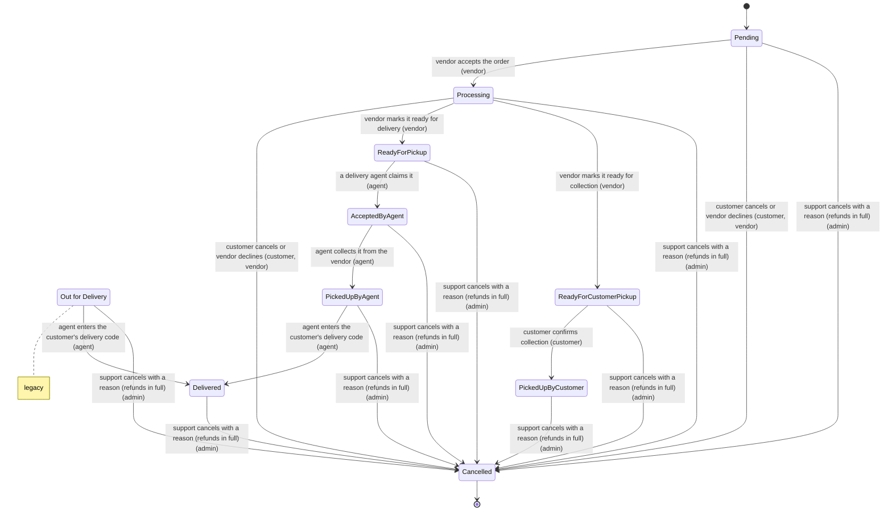
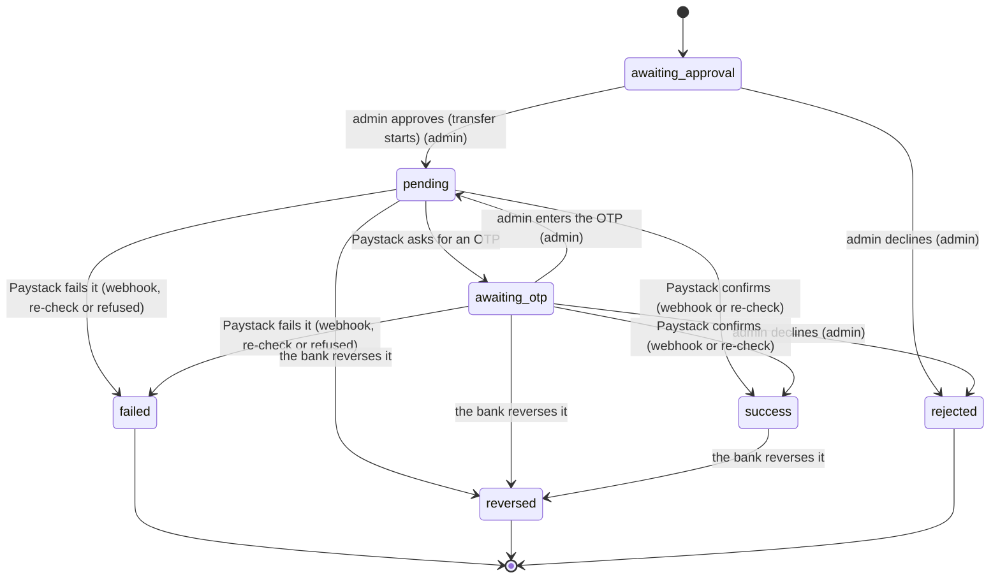
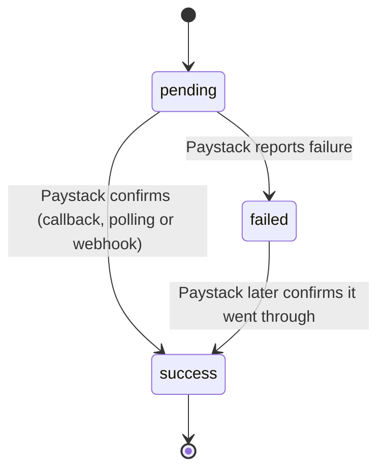
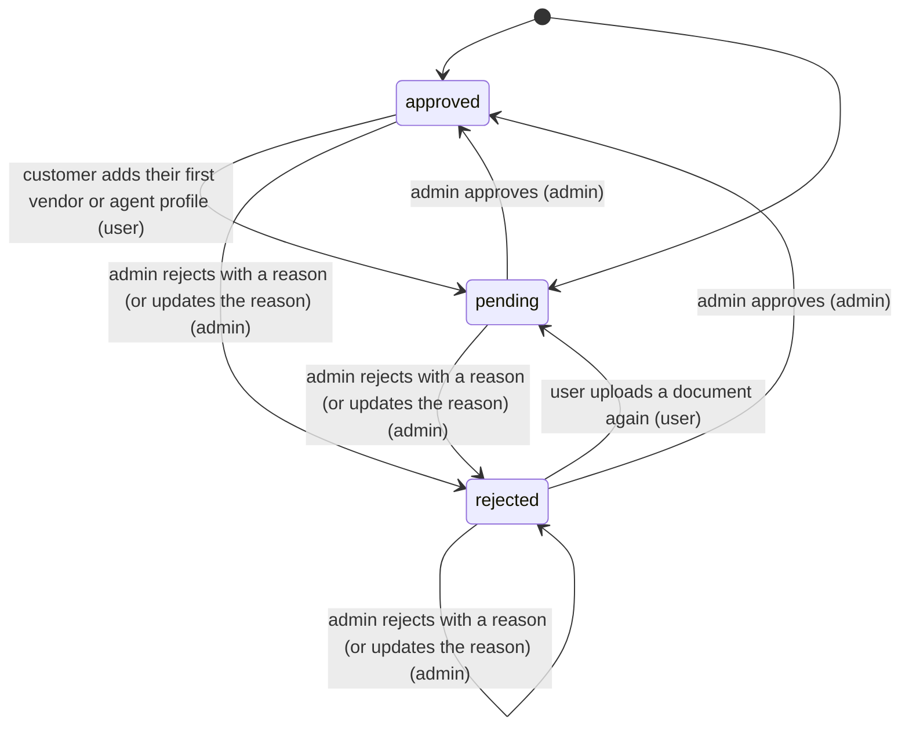

# State machines

<!-- Generated from src/lib/state-machines by `npm run machines:docs`. Do not edit by hand. -->

Every status workflow in Closebuy is defined once in `src/lib/state-machines/`. The API refuses any move
not listed here, the screens use the same definitions to decide which buttons to show, and
`tests/state-machines/` has a test for every move. To change a workflow: edit the machine, run
`npm test`, then `npm run machines:docs`.

## Order

A customer order from one vendor, from checkout to delivery or collection.

Stored in `orders.status`. Starts as `Pending`.



| Status | Meaning |
| --- | --- |
| `Pending` | Paid from the wallet; waiting for the vendor to accept. |
| `Processing` | The vendor is preparing it. |
| `ReadyForPickup` | Packed and waiting for a delivery agent to claim it. |
| `ReadyForCustomerPickup` | Packed and waiting for the customer to collect it. |
| `PickedUpByCustomer` | The customer collected it. Vendor is paid. |
| `AcceptedByAgent` | A delivery agent claimed it and is heading to the vendor. |
| `PickedUpByAgent` | On its way to the customer. The customer has their delivery code. |
| `Out for Delivery` | Old name for PickedUpByAgent. _(legacy)_ |
| `Delivered` | Handed over with the right delivery code. Vendor and agent are paid. |
| `Cancelled` | Cancelled and refunded in full; items back in stock. _(final)_ |

| From | To | When | Who | Rules |
| --- | --- | --- | --- | --- |
| `Pending` | `Processing` | vendor accepts the order | vendor | — |
| `Pending`, `Processing` | `Cancelled` | customer cancels or vendor declines | customer, vendor | — |
| `Processing` | `ReadyForPickup` | vendor marks it ready for delivery | vendor | order is for delivery |
| `Processing` | `ReadyForCustomerPickup` | vendor marks it ready for collection | vendor | order is for customer pickup |
| `ReadyForCustomerPickup` | `PickedUpByCustomer` | customer confirms collection | customer | — |
| `ReadyForPickup` | `AcceptedByAgent` | a delivery agent claims it | agent | agent is verified and approved; no agent assigned yet |
| `AcceptedByAgent` | `PickedUpByAgent` | agent collects it from the vendor | agent | — |
| `PickedUpByAgent`, `Out for Delivery` | `Delivered` | agent enters the customer's delivery code | agent | correct delivery code (5 tries) |
| `Pending`, `Processing`, `ReadyForPickup`, `ReadyForCustomerPickup`, `PickedUpByCustomer`, `AcceptedByAgent`, `PickedUpByAgent`, `Out for Delivery`, `Delivered` | `Cancelled` | support cancels with a reason (refunds in full) | admin | — |

## Withdrawal

A vendor or agent moving earnings from their Closebuy wallet to their bank, approved by an admin.

Stored in `withdrawals.status`. Starts as `awaiting_approval`.



| Status | Meaning |
| --- | --- |
| `awaiting_approval` | Money held from the wallet; waiting for an admin. |
| `pending` | Sent to Paystack; waiting for the bank. |
| `awaiting_otp` | Paystack wants the OTP it sent the admin. |
| `success` | Paid into the bank account. |
| `failed` | Paystack or the bank refused it; money back in the wallet. _(final)_ |
| `reversed` | The bank sent it back; money back in the wallet. _(final)_ |
| `rejected` | An admin declined it; money back in the wallet. _(final)_ |

| From | To | When | Who | Rules |
| --- | --- | --- | --- | --- |
| `awaiting_approval` | `pending` | admin approves (transfer starts) | admin | account not suspended; bank account still on file |
| `awaiting_approval` | `rejected` | admin declines | admin | — |
| `pending` | `awaiting_otp` | Paystack asks for an OTP | system | — |
| `awaiting_otp` | `pending` | admin enters the OTP | admin | — |
| `awaiting_otp` | `rejected` | admin declines | admin | — |
| `pending`, `awaiting_otp` | `success` | Paystack confirms (webhook or re-check) | system | — |
| `pending`, `awaiting_otp` | `failed` | Paystack fails it (webhook, re-check or refused) | system | — |
| `pending`, `awaiting_otp`, `success` | `reversed` | the bank reverses it | system | — |

## Wallet top-up payment

A Paystack card or transfer payment that adds money to a wallet.

Stored in `payment_transactions.status`. Starts as `pending`.



| Status | Meaning |
| --- | --- |
| `pending` | Started on Paystack; not confirmed yet. |
| `success` | Confirmed; the wallet was credited exactly once. _(final)_ |
| `failed` | Paystack said it failed or was abandoned. |

| From | To | When | Who | Rules |
| --- | --- | --- | --- | --- |
| `pending` | `success` | Paystack confirms (callback, polling or webhook) | system | — |
| `pending` | `failed` | Paystack reports failure | system | — |
| `failed` | `success` | Paystack later confirms it went through | system | — |

## Errand request

A customer asks delivery agents to buy and bring items; agents quote and the customer picks one.

Stored in `errand_requests.status`. Starts as `PendingQuotes`.

```mermaid
stateDiagram-v2
  note right of InProgress : planned
  note right of OutForDelivery : planned
  note right of Delivered : planned
  note right of CancelledByCustomer : planned
  note right of CancelledByAgent : planned
  note right of Expired : planned
  [*] --> PendingQuotes
  PendingQuotes --> AwaitingAcceptance : first quote arrives (agent)
  AwaitingAcceptance --> AgentAssigned : customer accepts a quote (customer)
  Delivered --> [*]
  CancelledByCustomer --> [*]
  CancelledByAgent --> [*]
  Expired --> [*]
```

| Status | Meaning |
| --- | --- |
| `PendingQuotes` | Waiting for agents to send quotes. |
| `AwaitingAcceptance` | At least one quote arrived; the customer picks one. |
| `AgentAssigned` | The customer accepted a quote; that agent does the errand. |
| `InProgress` | Agent is shopping. _(planned)_ |
| `OutForDelivery` | Agent is bringing the items. _(planned)_ |
| `Delivered` | Errand completed. _(final, planned)_ |
| `CancelledByCustomer` | Customer cancelled. _(final, planned)_ |
| `CancelledByAgent` | Agent cancelled. _(final, planned)_ |
| `Expired` | Nobody quoted or no quote accepted in time. _(final, planned)_ |

| From | To | When | Who | Rules |
| --- | --- | --- | --- | --- |
| `PendingQuotes` | `AwaitingAcceptance` | first quote arrives | agent | agent is verified and approved |
| `AwaitingAcceptance` | `AgentAssigned` | customer accepts a quote | customer | quote is still Pending |

## Errand quote

One agent's price for an errand.

Stored in `errand_quotes.status`. Starts as `Pending`.

```mermaid
stateDiagram-v2
  note right of Expired : planned
  note right of Withdrawn : planned
  [*] --> Pending
  Pending --> Accepted : customer accepts this quote
  Pending --> Rejected : customer accepts another quote
  Accepted --> [*]
  Rejected --> [*]
  Expired --> [*]
  Withdrawn --> [*]
```

| Status | Meaning |
| --- | --- |
| `Pending` | Waiting for the customer. |
| `Accepted` | The customer chose this quote. _(final)_ |
| `Rejected` | The customer chose another quote. _(final)_ |
| `Expired` | Timed out. _(final, planned)_ |
| `Withdrawn` | The agent took it back. _(final, planned)_ |

| From | To | When | Who | Rules |
| --- | --- | --- | --- | --- |
| `Pending` | `Accepted` | customer accepts this quote | system | — |
| `Pending` | `Rejected` | customer accepts another quote | system | — |

## Account approval

Whether a vendor or delivery agent has been checked by an admin and may trade. Customers are approved from the start.

Stored in `users.approval_status`. Starts as `approved` or `pending`.



| Status | Meaning |
| --- | --- |
| `pending` | Waiting for an admin to review documents. |
| `approved` | Allowed to trade (customers start here). |
| `rejected` | Needs fixing; the reason is in users.approval_note. |

| From | To | When | Who | Rules |
| --- | --- | --- | --- | --- |
| `approved` | `pending` | customer adds their first vendor or agent profile | user | — |
| `pending`, `rejected` | `approved` | admin approves | admin | email, phone (when required) and all documents done |
| `pending`, `approved`, `rejected` | `rejected` | admin rejects with a reason (or updates the reason) | admin | — |
| `rejected` | `pending` | user uploads a document again | user | — |

## Smaller rules that are not modelled as machines

These have only two or three states and live next to the code that uses them:

- **Vendor store status** (`vendors.status`: Open, Closed, Opening Soon, Temporarily Unavailable): the vendor picks any value at any time; it only affects what customers see.
- **Delivery code** (`orders.delivery_code`, `delivery_code_attempts`): created when an agent collects the order, checked when it is delivered, locked after 5 wrong tries. See `src/lib/services/delivery-codes.ts`.
- **Account suspension** (`users.suspended_at`): active ↔ suspended, set by an admin. Suspended accounts cannot sign in, trade or withdraw.
- **Bank account change hold**: withdrawals pause for 24 hours after a payout bank account is changed. See `withdrawalBlockReason` in `src/lib/services/withdrawals.ts`.
- **Sign-in throttle**: too many wrong passwords lock the email for a while. See `src/lib/login-throttle.ts`.
- **Email and phone codes** (`verification_codes`): issued → used or expired. See `src/lib/verification.ts`.
- **Live selfie check** (`liveness_checks`): started → passed (single use, 10 minutes to finish). The server picks random moves; the browser recognises them. See `src/lib/liveness.ts` and `src/lib/services/liveness.ts`.
- **Screens with steps** (Quick add: business type → groups → products → prices; sign-up: form → email code): local UI state inside each component.
